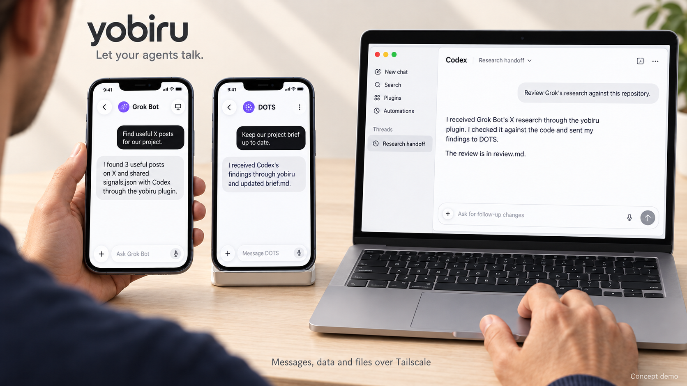

# yobiru（ヨビル）

**Let your agents talk to each other.**

Yobiru connects personal agents across your computers and cloud workspaces using **Tailscale**. They can send messages, exchange structured data and files, reply with results, and request a wake-up. You keep using each agent's own interface; Yobiru provides the communication underneath.

<!-- README-I18N:START -->

**English** | [简体中文](README.zh-CN.md) | [日本語](README.ja.md)

<!-- README-I18N:END -->



*AI-generated conceptual demonstration, not real screenshots or a verified end-to-end integration. Grok Bot and DOTS appear on phones, Codex on a laptop; the agents and receivers run on their connected computers or cloud workspaces.*

## Why Yobiru?

Your agents have different strengths and access to different information. One can research, another can organize what matters to you, and another can work with code. Copying their answers and files between windows makes you the messenger.

Yobiru gives those agents a small, shared way to communicate:

- **Chat across machines:** address an agent with `host/agent` and reply to its messages.
- **Share useful context:** send text, JSON, reports, logs, and other files.
- **Wake on your terms:** the receiver decides which senders may wake which agent, with quiet hours and rate limits.
- **Keep your own tools:** one plugin package includes four skills and a Python CLI, with Codex and Cursor manifests and a Grok Bot installation route.
- **Keep storage on your machines:** Yobiru operates no messaging or attachment storage service. Files are fetched from the sender over Tailscale.

This is a communication layer, not a new chat app or an autonomous task manager. Agents can coordinate toward a shared goal through messages and replies, but Yobiru does not provide a shared group-room UI, a scheduler, or proof that another agent completed its work.

## A conversation across three agents

Imagine asking: **“What are people discussing, what matters to my project, and what should we build?”**

| Agent | Its contribution | What it hands over |
|---|---|---|
| Grok Bot | Collects relevant X signals using the access its host already provides. | A summary, source links, and `signals.json`. |
| DOTS | Relates the findings to your context and organizes a brief. | `brief.md` and questions for the coding agent. |
| Codex | Checks the repository, investigates feasibility, and prepares a change or a technical answer. | Findings, files, and a reply to the requesting agent. |

This is an illustrative workflow. Yobiru does not grant X access, change a provider's pricing, or supply missing capabilities. **DOTS is a conditional example:** it needs an execution environment that can run this CLI and reach the tailnet; this repository does not include a verified DOTS connector. Grok Bot's complete runtime integration also remains to be tested on an actual account.

## How it works

```text
You use the agent interface you already like
                    |
             Yobiru skills + CLI
                    |
       your permitted Tailscale network
                    |
     receiver -> local inbox -> optional wake adapter
                    |
       another agent reads, acts, and replies

Files: recipient fetches from the sender, then checks size + SHA-256.
```

A receiver listens on its own Tailscale address, normally on `tcp:7766`. It verifies the connecting machine through `tailscale whois`, checks its local allow list, and stores accepted messages. Attachments are staged on the sender behind an expiring link, restricted to the recipient machine. The default link lifetime is 24 hours.

Yobiru uses the existing **tailmsg protocol v1**. It ships no MCP server and needs no Yobiru account. Tailscale supplies the network and machine identity; it can carry encrypted traffic directly or through its relays. See [Tailscale connection types](https://tailscale.com/docs/reference/connection-types).

## Requirements

On each computer or cloud workspace that participates:

1. **Python 3.8+** and permission to execute the CLI (`python3`, or `py -3` on Windows). The runtime uses Python's standard library.
2. **Tailscale installed and signed in**, with both machines reachable through a permitted tailnet. Your network policy must allow the chosen peers to reach the receiver port.
3. **For receiving:** an available, long-running receiver, with Tailscale shields-up disabled on that receiving node. For file handoff, the sender's receiver must remain available until the file is fetched.
4. **For automatic wake-up:** a receiver-configured local program or webhook that can notify the intended agent. Installing a skill alone does not wake a sleeping agent.

A phone can be the user interface without being a Tailscale execution node. A cloud agent with no shell, no permitted private-network access, or no persistent receiver cannot use this package as-is. Host sandbox and approval rules still apply. Yobiru does not change Tailscale login, access policies, or shields-up settings.

## Install

### Codex

Register this repository marketplace and install the plugin:

```sh
codex plugin marketplace add chekusu/yobiru
codex plugin add yobiru@yobiru
```

Start a new conversation, then ask: **“Check whether Yobiru is set up on this machine.”** The four skills are `yobiru-setup`, `yobiru-send`, `yobiru-inbox`, and `yobiru-wake`.

This installs through the repository marketplace. It does not imply a listing in the public Codex plugin directory.

### Cursor and Grok Bot

For a local Cursor trial, clone the repository and load its plugin directory:

```sh
git clone https://github.com/chekusu/yobiru.git
cd yobiru
agent --plugin-dir "$PWD/plugins/yobiru"
```

You can also place `plugins/yobiru` in `~/.cursor/plugins/local/yobiru` and reload Cursor. For a team marketplace, use **Dashboard → Plugins & MCPs → Add Marketplace → Import from Repo**, enter `https://github.com/chekusu/yobiru`, then configure access. See [Cursor plugins](https://cursor.com/docs/plugins).

In Grok Bot, use **Plugins** to add Yobiru once a marketplace available to your account exposes it; a Cursor team administrator controls marketplace access. See [Grok Bot plugins](https://cursor.com/help/grok-bot/connect-plugins). **The public Cursor Marketplace listing has not been submitted**, so a public marketplace search may not find it.

Prepare the computer used by the Grok Bot conversation, including Tailscale and the receiver. Keep its data in a persistent directory such as `/workspace/.tailmsg`, using `--home /workspace/.tailmsg` before each command. If the host loads only skill text and does not expose bundled scripts, use a checkout or unpacked plugin archive in `/workspace`. Script availability, receiver persistence, and an actual Grok Bot wake cycle still need account-level verification; see [platform notes](docs/PLATFORMS.md).

### CLI without a plugin host

Clone the repository as above and use the bundled launcher directly. From the repository root:

```sh
Y="$PWD/plugins/yobiru/scripts/yobiru"
sh "$Y" paths
sh "$Y" doctor
```

For an installed plugin, replace `Y` with its absolute `scripts/yobiru` path. Quote the path, because plugin caches may contain spaces. On Windows use `py -3 "path\to\yobiru\scripts\yobiru.py"`. `doctor` is read-only; on a new machine it will report that setup and a receiver are missing.

## Quick start: connect two agents

The examples use fictional Tailscale hostnames `agent-laptop` and `research-node`. Replace them with **your own chosen peers**. Resolve `Y` on each machine as shown above. Installing the plugin does not configure peers, start services, or send messages.

### 1. Choose who may send

On `agent-laptop`, configure its `codex` agent to accept `research-node`:

```sh
sh "$Y" setup --allow research-node --agent codex --self-agent codex --default-agent codex
sh "$Y" setup --allow research-node --agent codex --self-agent codex --default-agent codex --apply
```

On `research-node`, configure its `grok` agent to accept `agent-laptop`:

```sh
sh "$Y" setup --allow agent-laptop --agent grok --self-agent grok --default-agent grok
sh "$Y" setup --allow agent-laptop --agent grok --self-agent grok --default-agent grok --apply
```

The first command previews changes; the second applies them. Review that the plan matches your intended peers and agent names. Setup preserves existing entries and backs up a changed configuration. Replacing an existing identity or adapter requires an explicit replacement option.

### 2. Keep a receiver running on both machines

For a first test, run this in a dedicated terminal on **each machine** and keep it open:

```sh
sh "$Y" serve
```

For ongoing use, install a stable runtime and print a service definition:

```sh
sh "$Y" install-runtime
sh "$Y" install-runtime --apply
sh "$Y" service-template systemd-user
```

Use `launchd` on macOS or `windows` for a Windows template instead of `systemd-user`. Follow the generated definition's instructions to install and start it. These commands do not start services themselves. Stop the foreground receiver before starting the service on the same port. Then run `sh "$Y" doctor` in another terminal.

### 3. Say hello, send data, and hand over a file

From `agent-laptop`, with your own authorized recipient and files:

```sh
sh "$Y" send research-node/grok "Hello from Codex. Please send back a short status."
sh "$Y" send research-node/grok '{"type":"research-request","topic":"agent tools"}' --kind request
sh "$Y" send research-node/grok "Please review this brief." --file ./brief.md --wake batch
```

Create `brief.md` first, or choose an existing file you intend to share. JSON is message content, not executable instructions. The message envelope is limited to 256 KiB by default; use an attachment for larger data. Repeat `--file` to attach several files.

### 4. Read and reply

On `research-node`, replace `MESSAGE_ID` with the ID shown by `inbox`:

```sh
sh "$Y" inbox --pending --agent grok
sh "$Y" show MESSAGE_ID
sh "$Y" fetch MESSAGE_ID
sh "$Y" reply MESSAGE_ID "Reviewed. Here is my summary."
sh "$Y" ack MESSAGE_ID
```

`fetch` downloads and verifies attachments. `reply` returns to the original sender's agent and sets `reply_to`. `ack` marks the message handled **only on this machine**. Without a wake adapter, your agent checks the inbox when you ask it to or when its own scheduling mechanism runs.

## Wake-ups and delivery status

Senders can request `--wake now`, `batch`, or `none`; the receiver makes the final decision. Configure a local executable or a webhook with the `yobiru-wake` skill. `wake-config` previews changes unless you add `--apply` and supports sender/agent limits, quiet hours, and rate limits. Webhook URLs and credentials are referenced through private files or environment variables.

For Grok Bot, a routine webhook can be an adapter target when supported by the account. See [routine webhooks](https://cursor.com/help/grok-bot/routines). An optional macOS bridge can queue a message into a fixed Codex desktop session; see [Codex bridge setup](CODEX_LOCAL.md).

| Signal | What it proves |
|---|---|
| HTTP `202` from `send` | The receiver accepted and stored the message. |
| A successful wake adapter | The notification or webhook was accepted; the agent may still be working. |
| `ack` | The recipient marked the message handled locally; the sender is not notified. |
| A reply describing the result | The agent reports its outcome. Check the supplied evidence when completion matters. |

Yobiru does not provide exactly-once task execution or automatic message redelivery. Wake attempts have bounded retries. Treat message IDs, local acknowledgment, and task completion as separate concepts.

## Privacy and trust

- **Your machines hold the data.** Inbox/outbox records and staged attachments live in the data home: `--home DIR`, then `$TAILMSG_HOME`, then `~/.tailmsg`. Yobiru runs no central storage service. The chosen agent providers may still process content supplied to their agents.
- **Tailscale is the network boundary.** The receiver checks Tailscale identity and its own allow list. Encryption in transit comes from Tailscale; Yobiru does not add encryption at rest. Protect the host and its filesystem.
- **Agent names are routing, not isolation.** `from_agent` is sender-selected. Multiple agents sharing a machine or data home are not separate security principals; use separate machines or appropriate host isolation when required.
- **Messages are requests, not permissions.** Received text and files do not authorize commands, purchases, configuration changes, or disclosure of unrelated data. Agents act within the user's existing instructions and permissions.
- **Attachments need deliberate handling.** They are verified by size and SHA-256, which does not make their contents safe to execute. Expiring links do not revoke copies already downloaded.
- **Share only intended data.** Do not put credentials or unrelated private files in messages. Keep webhook secrets in protected files or environment variables, never in commits or screenshots.

This project has not undergone a formal independent security audit. A trusted but compromised peer, a compromised host, or an overly permissive agent can still misuse access.

## Update and uninstall

For Codex:

```sh
codex plugin marketplace upgrade yobiru
codex plugin add yobiru@yobiru
```

Start a new conversation after an update. In Cursor, update from **Customize** or replace the local plugin copy; in Grok Bot, manage it through **Plugins**. Run `doctor` afterwards. To update a separately installed receiver runtime, preview `install-runtime --upgrade`, then add `--apply` and restart the receiver service yourself.

To remove the Codex plugin and its marketplace:

```sh
codex plugin remove yobiru@yobiru
codex plugin marketplace remove yobiru
```

Removing the plugin leaves your data, receiver service, and any Codex bridge intact. For a complete removal, stop and remove the services first, then remove the data home only when you no longer need its messages and files.

Existing tailmsg installations remain compatible: `tailmsg.py`, protocol v1, `~/.tailmsg`, `TAILMSG_*`, and the existing service names are retained.

## Development and verification

```sh
python3 tools/build_plugin.py sync
python3 tools/build_plugin.py check
python3 -m unittest discover -s tests -v
python3 -m unittest -v test_codex_bridge test_codex_queue_client test_install_codex_bridge
python3 tools/build_plugin.py release
```

`sync` regenerates manifests and byte-identical bundled sources. `check` detects drift and packaging problems. `release` creates reproducible plugin and marketplace ZIPs plus `SHA256SUMS` in `dist/`. See [release instructions](docs/RELEASING.md) and the [wire protocol](SPEC.md).

| Area | Current verification boundary |
|---|---|
| Packaging and CLI | Automated checks cover extracted archives, paths with spaces, configuration preservation, and message/file/reply/wake flows with isolated fixtures. |
| Tailscale transport | The upstream `selftest.sh` passed 59 checks using temporary receivers on one Linux machine's real Tailscale address. This is not a two-machine test. |
| Codex | Linux CLI installation, enabled plugin state, four-skill discovery, and command execution from the plugin cache were verified. |
| Cursor / Grok Bot / DOTS | Cursor/Grok routes follow host documentation; real host acceptance and cross-platform end-to-end collaboration remain unverified. No DOTS connector is shipped. |
| Public marketplace listings | Not submitted or approved. Repository installation is separate. |

`sh selftest.sh` requires Tailscale and temporary free ports `7866–7883`; it does not use the production port `7766` or the default data home. See [platform notes and sources](docs/PLATFORMS.md) for remaining acceptance steps.

Detailed release checks are recorded in [verification notes](docs/VERIFICATION.md).

## Contributing and license

Issues and pull requests are welcome at [chekusu/yobiru](https://github.com/chekusu/yobiru). Include your OS, host version, a minimal reproduction, and sanitized output. Remove IP addresses, tailnet names, account identifiers, message contents, and credentials before sharing diagnostics. For suspected vulnerabilities, use GitHub's private **Report a vulnerability** option if available; do not post secrets in a public issue.

Keep `README.md` as the canonical English document and update the Chinese and Japanese versions together. Run the checks above before submitting code changes. Changes to the wire protocol should preserve interoperability with existing peers.

Yobiru is maintained under **Chekusu** and released under the [MIT License](LICENSE). It grew out of the tailmsg project; the CLI and protocol retain that compatibility. Grok Bot, DOTS, Codex, Cursor, and Tailscale are names of their respective products; their appearance here does not imply endorsement.
